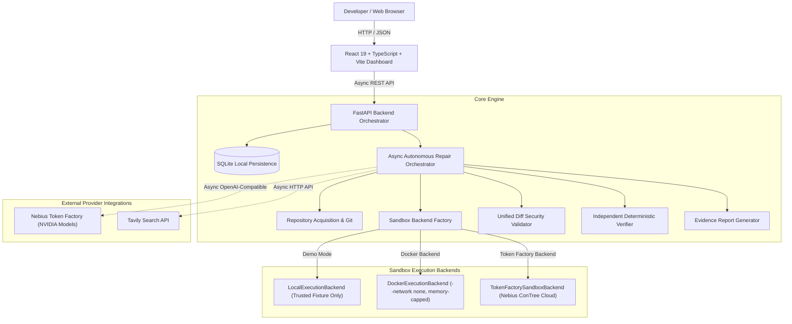

# ProofPatch — AI Repairs You Can Verify

> **Autonomous bug fixing with verifiable evidence.**
> Built from scratch for the **Nebius x NVIDIA Global AI Hackathon** (Track: *Coding & Agentic Engineering*, Secondary Objective: *Best Use of Tavily*).

[](https://github.com/VaibhavSoni24/ProofPatch/actions/workflows/ci.yml)
[](LICENSE)
[](backend/)
[](frontend/)
[](backend/)
[](docs/TESTING.md)

---

## The Problem

AI coding assistants can generate code snippets in seconds, but **generated code is not proof that a bug was fixed**.
Plausible-sounding patches frequently:
- Fail boundary edge cases.
- Break existing test suites.
- Introduce silent regressions or security vulnerabilities.

Developers waste significant engineering hours manually reproducing defects and cross-examining generated pull requests. A patch without verifiable reproduction and passing regression tests is an unverified hypothesis, not a solution.

---

## The ProofPatch Promise

ProofPatch transforms bug fixing from an ungrounded chat interaction into a **traceable, auditable engineering pipeline**:

1. **Inspects** the repository without context bloat.
2. **Reproduces** the reported defect in an isolated sandbox using real test commands (`Exit Code != 0`). Halts as `INCONCLUSIVE` if tests pass or fail due to unrelated environment issues.
3. **Diagnoses** the exact technical root cause using structured model schemas via **Nebius Token Factory**.
4. **Researches** relevant framework documentation and API changes via **Tavily Search API**.
5. **Synthesizes** a minimal, surgical unified diff.
6. **Validates** patch security (strictly preventing path traversal, protected files, and bounding byte caps).
7. **Executes** regression tests in isolated sandboxes (`Exit Code == 0`).
8. **Audits** 6 independent verification criteria before declaring success.
9. **Persists** a structured, downloadable evidence report with raw command logs.

---

## Key Differentiators

- **Observable Evidence Workflow**: Every claim is backed by real executed commands, timestamps, and exit codes. Never presents a generated explanation as a success without executable proof. Missing exit codes are strictly rejected and never defaulted to success.
- **Zero-Credit Offline Demonstration**: Ships with a deterministic local demo featuring an intentionally buggy SaaS billing service (`examples/buggy-python-service/`). Runs out of the box on an ordinary laptop with zero API keys or cloud GPUs.
- **Unified Production Container**: Multi-stage root `Dockerfile` packages the React frontend and asynchronous FastAPI backend into a single container serving both API and static assets from the same origin on port 8000.
- **Nebius Token Factory Adapter**: Fully asynchronous OpenAI-compatible adapter targeting eligible open-source **NVIDIA** reasoning models.
- **Nebius ConTree Sandbox Integration**: Uses official `contree-sdk` and `contree-client` (`ContreeAsyncClient`, `Contree`, `UploadFileSpec`) for isolated cloud container sessions, transferring bounded repository files via `image.run(files=[...], disposable=False)`, installing manifest dependencies in-container, enforcing strict exit code validation, and releasing resources cleanly upon completion.
- **Tavily Research Integration**: Targeted asynchronous search retrieving real documentation, change logs, and technical discussions.
- **Strict Sandbox Boundaries**: Disposable workspace checkouts, environment sanitization (secrets stripped from subprocesses), path traversal rejection (`../`), and container isolation.

---

## System Architecture



---

## Technology Stack

- **Frontend**: React 19, TypeScript, Vite, custom responsive dark CSS design system, Lucide React icons, Vitest, React Testing Library.
- **Backend**: Python 3.10+, FastAPI (fully asynchronous), Pydantic & Pydantic Settings, SQLAlchemy, SQLite, HTTPX, Pytest, Ruff.
- **Inference Integration**: Asynchronous OpenAI-compatible adapter for Nebius Token Factory (`api.tokenfactory.nebius.com`).
- **Research Integration**: Asynchronous Tavily Search API client.
- **Isolation & Sandboxing**: `LocalExecutionBackend` (demo only), `DockerExecutionBackend` (non-networked local container), and `TokenFactorySandboxBackend` (Nebius ConTree cloud container runtime).
- **Production Packaging**: Multi-stage Docker container serving unified SPA + API on port 8000, Docker Compose, and Render Blueprint (`render.yaml`).

---

## Repository Structure

```
ProofPatch/
├── .github/workflows/ci.yml       # GitHub Actions automated test & build pipeline (backend, frontend, docker)
├── .env.example                   # Authoritative configuration template
├── .editorconfig                  # Consistent formatting rules across languages
├── .gitignore                     # Strictly ignores .env, virtualenvs, local databases
├── .dockerignore                  # Strict exclusion rules for container build
├── Dockerfile                     # Multi-stage production container (Node 20 build + Python 3.11 runtime)
├── docker-compose.yml             # Single-command local containerized deployment
├── render.yaml                    # Render Blueprint specification for Docker web service
├── Makefile                       # Development task orchestration
├── LICENSE                        # MIT License
├── SECURITY.md                    # Vulnerability reporting and security architecture
├── CONTRIBUTING.md                # Contribution guidelines and commit discipline
│
├── backend/                       # Python FastAPI Backend
│   ├── pyproject.toml             # Python package metadata and dependencies
│   ├── Dockerfile                 # Standalone backend container definition
│   ├── app/
│   │   ├── main.py                # FastAPI entrypoint, SPA static serving, CORS setup
│   │   ├── api/                   # REST endpoints (health, config-status, runs)
│   │   ├── core/                  # Settings, structured logging, error hierarchy
│   │   ├── db/                    # SQLAlchemy models, SQLite session
│   │   ├── schemas/               # Pydantic request and response schemas
│   │   ├── providers/             # Nebius Token Factory and Tavily adapters
│   │   ├── repositories/          # GitHub URL validation and inspection
│   │   ├── agents/                # Async orchestrator, prompts, patch parser, and verifier
│   │   ├── sandbox/               # Local, Docker, and Token Factory ConTree sandbox backends
│   │   └── services/              # Demo runner, evidence generator, run manager
│   └── tests/                     # 128 backend unit, security, sandbox, static & verifier tests
│
├── frontend/                      # React TypeScript Frontend
│   ├── package.json               # Node dependencies and scripts
│   ├── vite.config.ts             # Vite configuration with proxy and Vitest
│   ├── tsconfig.json              # TypeScript compilation settings
│   └── src/
│       ├── components/            # Header, Navigation, Demo Banner
│       ├── features/              # Dashboard, New Repair, Run Details, Evidence, Settings
│       ├── lib/api.ts             # Typed REST API client
│       ├── styles/index.css       # Complete dark modern design system
│       └── tests/                 # Vitest frontend tests
│
├── examples/buggy-python-service/ # Bundled reproducible SaaS billing service
│   ├── README.md                  # Defect documentation (Issue #104)
│   ├── src/billing.py             # Boundary defect (seats > 6 vs seats >= 6)
│   └── tests/test_billing.py      # Deterministic failing test case
│
├── docs/                          # Comprehensive technical documentation
│   ├── ARCHITECTURE.md            # High-level architecture, state transitions, schemas
│   ├── CONFIGURATION.md           # Every environment variable documented
│   ├── TESTING.md                 # Test suite breakdown and reproduction guide
│   ├── DEMO_SCRIPT.md             # Timed 2-minute video walkthrough script
│   ├── HACKATHON_SUBMISSION.md    # Hackathon submission draft
│   └── DEVELOPMENT_LOG.md         # Factual engineering trajectory log
│
└── scripts/                       # Developer bootstrap and verification scripts
    ├── setup.ps1 / setup.sh       # One-click environment bootstrap
    └── check.ps1 / check.sh       # Full verification suite execution
```

---

## Quick Start (Zero-Credit Local Demo)

### Prerequisites
- **Python 3.10+**
- **Node.js 18+ and npm**
- **Git**

### 1. Clone the Repository
```bash
git clone https://github.com/VaibhavSoni24/ProofPatch.git
cd ProofPatch
```

### 2. Setup and Run Backend

#### On Windows PowerShell:
```powershell
python -m venv .venv
.\.venv\Scripts\Activate.ps1
pip install -e backend
uvicorn app.main:app --app-dir backend --reload --port 8000
```

#### On Linux / macOS:
```bash
python3 -m venv .venv
source .venv/bin/activate
pip install -e backend
uvicorn app.main:app --app-dir backend --reload --port 8000
```

Backend API will be running at `http://127.0.0.1:8000` (`http://127.0.0.1:8000/docs` for Swagger UI).

### 3. Setup and Run Frontend

In a separate terminal:
```bash
cd frontend
npm install
npm run dev
```

Open your browser at `http://localhost:5173`.

### 4. Run the Zero-Credit Demo
Click **Run Demo Repair** in the top navigation bar. ProofPatch will:
1. Spin up an isolated copy of the bundled SaaS billing service.
2. Run baseline `pytest` showing the exact assertion failure on `test_growth_tier_boundary_six_seats` (Exit Code 1).
3. Diagnose the boundary condition in `src/billing.py`.
4. Apply the minimal surgical patch (`seats > 6` -> `seats >= 6`).
5. Re-run tests showing all 7 regression tests passing (Exit Code 0).
6. Perform independent verification across 6 safety checks.
7. Generate and display the auditable evidence report available for instant Markdown and JSON download.

---

## Running the Automated Test Suites

ProofPatch includes 131 automated tests that execute with **zero external API requests**:

```bash
# Backend pytest suite (128 tests)
pytest backend/tests -v

# Backend code style and formatting
ruff check backend
ruff format --check backend

# Frontend test suite (3 tests)
cd frontend
npm test

# Frontend typechecking and production build
npm run typecheck
npm run build
```

Or run the all-in-one verification script:
- **Windows**: `.\scripts\check.ps1`
- **Linux/macOS**: `./scripts/check.sh`

---

## Production Container & Cloud Deployment

ProofPatch packages the React frontend and FastAPI backend into a single production Docker container that serves both static assets and API routes from the same origin on port 8000.

### 1. Run with Docker Compose (Local Single-Container Demo)
```bash
docker compose up --build
```
- Opens at `http://localhost:8000` serving the built frontend and backend together.
- Defaults safely to `PROOFPATCH_MODE=demo` (requires no external API keys or cloud credentials).
- Automatically runs as unprivileged user `proofpatch` and stores persistent SQLite data in the `proofpatch-data` volume.

### 2. Manual Docker Build & Run
```bash
# Build multi-stage image
docker build -t proofpatch:latest .

# Run container on port 8000
docker run -d --name proofpatch -p 8000:8000 -e PROOFPATCH_MODE=demo proofpatch:latest

# Verify health endpoint
curl http://localhost:8000/api/health
```

### 3. Deploying a Public Demo (Render Blueprint)
For a publicly accessible web demo URL:
1. Connect your GitHub repository to [Render](https://render.com).
2. Create a new **Blueprint** service pointing to the included [`render.yaml`](render.yaml).
3. Render automatically builds the multi-stage `Dockerfile` and configures the `/api/health` health check.

> [!NOTE]
> **Free Tier Hosting Considerations**:
> - **Spin-Down & Cold Start**: Free web services on Render spin down after 15 minutes of inactivity. When a request arrives, waking the container takes approximately 50 seconds.
> - **Ephemeral Storage**: Free instances use an ephemeral filesystem. Local SQLite runs and temporary workspaces reset when the container restarts. Persistent storage requires an attached disk (available on paid tiers).
> - **Zero-Credit Demo Safety**: The Blueprint defaults to `PROOFPATCH_MODE=demo`. The public demo executes the deterministic boundary defect repair without consuming inference credits.

---

## Configuring Live Mode (Nebius & Tavily)

ProofPatch defaults to `demo` mode. To activate genuine live model inference for public GitHub repositories:

1. Copy `.env.example` to your untracked `.env` (already created locally):
   ```bash
   cp .env.example .env
   ```
2. Open `.env` and configure:
   ```env
   # Switch mode to live
   PROOFPATCH_MODE=live

   # Nebius Token Factory Credentials
   NEBIUS_API_KEY=your_nebius_api_key_here
   NEBIUS_BASE_URL=https://api.tokenfactory.nebius.com/v1/

   # Configured eligible NVIDIA open-source model identifier
   # (Select active model string starting with nvidia/ from https://docs.tokenfactory.nebius.com/ or https://tokenfactory.nebius.com/models)
   NEBIUS_MODEL=nvidia/<selected-active-model-id>

   # Sandbox Backend: "docker" or "token_factory_sandbox"
   EXECUTION_BACKEND=docker
   # If using Token Factory sandbox:
   # CONTREE_TOKEN=your_contree_or_nebius_token

   # (Optional) Tavily Search for live documentation research
   TAVILY_API_KEY=your_tavily_api_key_here
   TAVILY_ENABLED=true

   # Enable external repository execution with user consent
   ALLOW_EXTERNAL_REPOSITORIES=true
   ```
3. Restart the backend server. The UI badge will update to `LIVE MODE`, and repairs will invoke Nebius and Tavily within strict budget caps (`MAX_MODEL_CALLS_PER_RUN=4`).

---

## Security Safeguards

- **Strict Credential Isolation**: Provider keys reside solely on the backend; the `/api/config-status` endpoint exposes only sanitized boolean flags. Secrets are scrubbed from logs, terminal outputs, and reports.
- **Unified Diff Validation**: Every patch is checked before application. Path traversals (`../`), absolute paths, and modifications to `.git`, `.env`, or configuration files are strictly rejected.
- **Execution Confinement**: External code runs inside disposable subdirectories. Docker isolation (`--network none`, memory & CPU limits) and Token Factory cloud sandboxes are supported.
- **No Uncontrolled Retries**: Strict budget limits prevent runaway token billing.

---

## Documentation Index

- [Architecture & Design Details](docs/ARCHITECTURE.md)
- [Configuration Reference](docs/CONFIGURATION.md)
- [Testing & Quality Assurance Guide](docs/TESTING.md)
- [2-Minute Video Demonstration Script](docs/DEMO_SCRIPT.md)
- [Hackathon Submission Draft](docs/HACKATHON_SUBMISSION.md)
- [Engineering Trajectory Log](docs/DEVELOPMENT_LOG.md)
- [Security Policy](SECURITY.md)
- [Contributing Guide](CONTRIBUTING.md)

---

## License

MIT License. Copyright (c) 2026 Vaibhav Soni.
