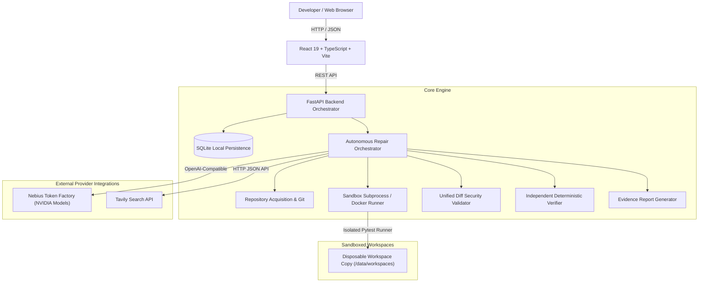
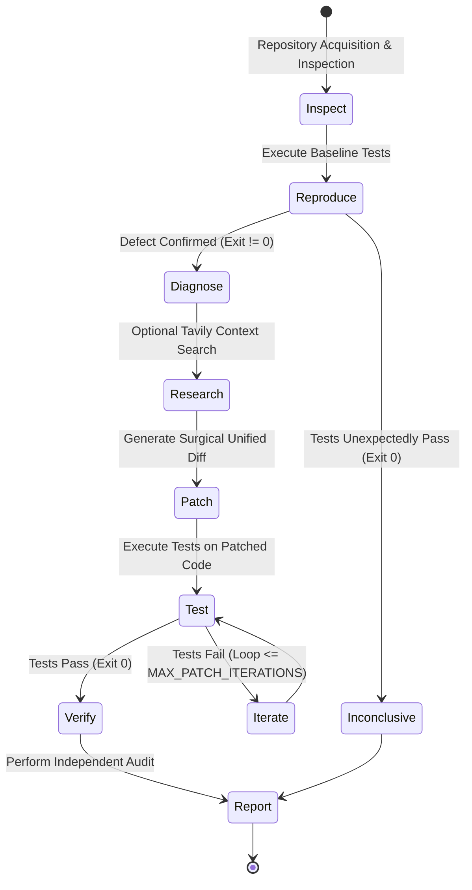
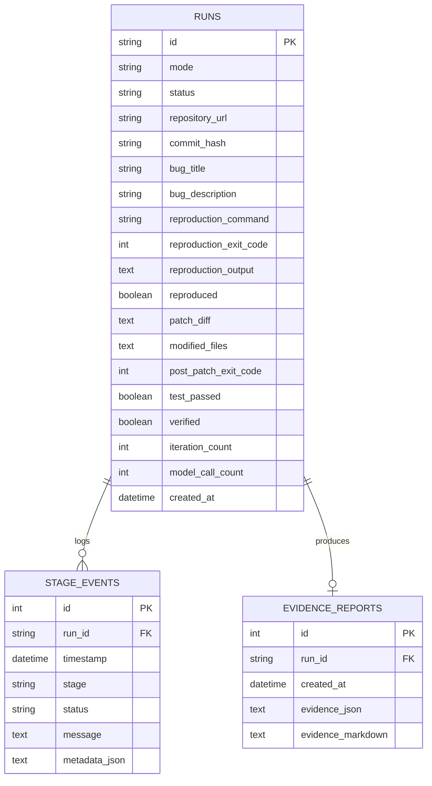

# ProofPatch Architecture & Technical Design

This document details the software architecture, orchestration pipeline, sandbox security boundaries, provider abstraction layer, and data persistence model of ProofPatch.

---

## 1. High-Level System Architecture

ProofPatch uses a modular monorepo architecture with clean boundaries separating user interfaces, REST endpoints, workflow orchestration, AI inference adapters, external research providers, safe sandbox execution, and persistent storage.

---

## 2. Request & Execution Lifecycle (The 10 Stages)

Every repair run transitions through an explicit, auditable sequence of stages:

### Stage Breakdown

1. **Stage 1: Repository Acquisition**:
   - Validates public GitHub URLs (rejecting credentials, insecure schemes, and malformed paths).
   - Shallow clones into an isolated temporary workspace directory under `data/workspaces/<run_id>`.
2. **Stage 2: Repository Inspection**:
   - Bounded directory scan ignoring `.git`, virtual environments, caches, and build folders.
   - Discovers test manifests (`pyproject.toml`, `requirements.txt`) and test files.
3. **Stage 3: Bug Reproduction**:
   - Executes allowlisted pytest command in the unpatched workspace.
   - Captures stdout/stderr, return code, and establishes verifiable proof of the bug. If reproduction fails (exit code 0), run halts safely as `INCONCLUSIVE`.
4. **Stage 4: Model-Driven Diagnosis**:
   - Sends issue description, failure trace, and code context to Nebius Token Factory.
   - Enforces a strict Pydantic JSON schema (`DiagnosisResult`).
5. **Stage 5: Optional Research (Tavily)**:
   - When configured, queries Tavily for relevant documentation, API updates, or known framework issues.
   - Attaches actual source URLs and excerpts to the evidence log.
6. **Stage 6: Patch Generation & Validation**:
   - Requests minimal unified diff targeting diagnosed lines.
   - Validates diff size (`MAX_PATCH_BYTES`), path safety (strictly rejecting traversal and protected files), and applies hunks cleanly.
7. **Stage 7: Test Execution**:
   - Executes pytest runner against the patched code.
8. **Stage 8: Bounded Repair Loop**:
   - If tests fail, feeds failure trace back to the model for a revised patch.
   - Strict caps: `MAX_PATCH_ITERATIONS=2`, `MAX_MODEL_CALLS_PER_RUN=4`.
9. **Stage 9: Independent Verification**:
   - Deterministically audits 6 concrete claims (exit codes, diff syntax, scope confinement, immutability of original repo, secret scrubbing).
10. **Stage 10: Evidence Report**:
    - Generates downloadable Markdown and JSON evidence documents with raw command logs.

---

## 3. Data Persistence Model

Local SQLite persistence is managed through SQLAlchemy.

---

## 4. Sandbox Security & Isolation Boundaries

1. **Host Immutability**:
   - Execution is strictly confined to disposable working directories under `data/workspaces/`. The user's original repository or parent workspace is never touched.
2. **Environment Sanitization**:
   - Subprocess environments are completely stripped of all API keys, tokens, and passwords (`PYTHONUNBUFFERED=1`, `PYTHONDONTWRITEBYTECODE=1`).
3. **No Shell Invocations**:
   - Commands are invoked as direct argument arrays (`[python_bin, "-m", "pytest", ...]`) without passing through shell interpreters (`shell=False`).
   - Semicolons, pipes (`|`), ampersands (`&&`), and shell meta-characters in arguments are strictly rejected by `sanitize_test_args()`.
4. **Credential Redaction**:
   - Logging formatters and verification scanners use regex patterns (`RE_SECRETS`) to scrub API tokens and bearer credentials from outputs and diffs before persistence or display.
