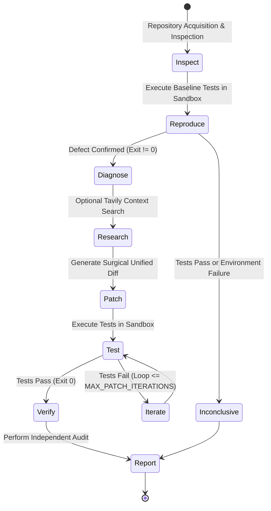

# ProofPatch Architecture & Technical Design

This document details the software architecture, asynchronous orchestration pipeline, sandbox execution backends, provider abstraction layer, and data persistence model of ProofPatch.

---

## 1. High-Level System Architecture

ProofPatch uses a modular monorepo architecture with clean boundaries separating user interfaces, REST endpoints, workflow orchestration, AI inference adapters, external research providers, safe sandbox execution, and persistent storage.

```mermaid
graph TD
    User["Developer / Web Browser"] -->|HTTP / JSON| Frontend["React 19 + TypeScript + Vite"]
    Frontend -->|REST API (Async)| API["FastAPI Backend Orchestrator"]
    subgraph Core Engine
        API --> DB[(SQLite Local Persistence)]
        API --> Orchestrator["Async Autonomous Repair Orchestrator"]
        Orchestrator --> RepoAcq["Repository Acquisition & Git"]
        Orchestrator --> SandboxFactory["Sandbox Backend Factory"]
        Orchestrator --> PatchParser["Unified Diff Security Validator"]
        Orchestrator --> Verifier["Independent Deterministic Verifier"]
        Orchestrator --> EvidenceService["Evidence Report Generator"]
    end

    subgraph Sandbox Execution Backends
        SandboxFactory -->|Demo Mode| LocalSandbox["LocalExecutionBackend (Trusted Fixture Only)"]
        SandboxFactory -->|Docker Backend| DockerSandbox["DockerExecutionBackend (--network none, memory-capped)"]
        SandboxFactory -->|Token Factory Backend| ConTreeSandbox["TokenFactorySandboxBackend (Nebius ConTree Cloud)"]
    end

    subgraph External Provider Integrations
        Orchestrator -->|Async OpenAI-Compatible| Nebius["Nebius Token Factory (NVIDIA Open Models)"]
        Orchestrator -->|Async HTTP API| Tavily["Tavily Search API (Doc Retrieval)"]
    end
```

---

## 2. Request & Execution Lifecycle (The 10 Stages)

Every repair run transitions through an explicit, auditable sequence of stages:



### Stage Breakdown

1. **Stage 1: Repository Acquisition**:
   - Validates public GitHub URLs (rejecting credentials, insecure schemes, and malformed paths).
   - Shallow clones into an isolated temporary workspace directory under `data/workspaces/<run_id>`.
2. **Stage 2: Repository Inspection**:
   - Bounded directory scan ignoring `.git`, virtual environments, caches, and build folders.
   - Discovers test manifests (`pyproject.toml`, `requirements.txt`) and source/test files.
3. **Stage 3: Bug Reproduction**:
   - Executes allowlisted pytest command inside the selected sandbox backend (`LocalExecutionBackend` for demo, `DockerExecutionBackend` or `TokenFactorySandboxBackend` for live).
   - Captures stdout/stderr and return code.
   - **Gating**: If tests pass cleanly (exit 0) or fail due to environmental/import errors, the run halts safely as `INCONCLUSIVE` without consuming inference tokens.
4. **Stage 4: Model-Driven Diagnosis**:
   - Awaits Nebius Token Factory inference using the configured eligible NVIDIA open model.
   - Enforces a strict Pydantic JSON schema (`DiagnosisResult`).
5. **Stage 5: Optional Research (Tavily)**:
   - When configured, queries Tavily for relevant documentation, API updates, or known framework issues.
   - Attaches actual source URLs and excerpts to the evidence log.
6. **Stage 6: Patch Generation & Validation**:
   - Requests minimal unified diff targeting diagnosed lines.
   - Validates diff size (`MAX_PATCH_BYTES`), path safety (strictly rejecting traversal and protected files), and applies hunks cleanly.
7. **Stage 7: Test Execution**:
   - Executes pytest runner against the patched code inside the isolated sandbox.
8. **Stage 8: Bounded Repair Loop**:
   - If tests fail, feeds failure trace back to the model for a revised patch.
   - Strict caps: `MAX_PATCH_ITERATIONS=2`, `MAX_MODEL_CALLS_PER_RUN=4`.
9. **Stage 9: Independent Verification**:
   - Deterministically audits 6 concrete claims (exit codes, diff syntax, scope confinement, immutability of original repo, secret scrubbing).
   - Marks status as `PASSED`, `FAILED`, `NOT_RUN`, or `INCONCLUSIVE`.
10. **Stage 10: Evidence Report**:
    - Generates downloadable Markdown and JSON evidence documents with raw command logs and audit tables.

---

## 3. Sandbox Architecture & Isolation Backends

To prevent third-party code execution vulnerabilities, ProofPatch establishes three explicit execution backend implementations:

### `LocalExecutionBackend`
- Restricted exclusively to the trusted bundled demo service (`examples/buggy-python-service/`).
- If attempted on an external repository in live mode, raises `SecurityError`.

### `DockerExecutionBackend`
- Default live execution backend.
- Enforces strict container isolation:
  - `--network none` (complete network disconnection)
  - `--memory 512m` (memory limit)
  - `--cpus 1.0` (CPU quota)
  - `--pids-limit 64` (fork-bomb defense)
  - Read-write volume strictly mounted to workspace directory only.
- Fails closed with actionable error if Docker daemon is unreachable.

### `TokenFactorySandboxBackend`
- Official Nebius ConTree cloud container sandbox adapter for SWE agents.
- Lifecycle:
  1. `acquire_session()`: provisions an isolated container session from `python:3.11-slim`.
  2. `execute_tests()`: runs test commands via remote REST execution API.
  3. `cleanup()`: releases and destroys remote container sessions upon run completion.
- Configured via `CONTREE_TOKEN` and `CONTREE_BASE_URL`.

---

## 4. Asynchronous Concurrency Model

All external I/O and orchestration logic use Python `asyncio`:
- **Provider Clients**: `NebiusTokenFactoryProvider` and `TavilySearchProvider` utilize non-blocking `httpx.AsyncClient` instances.
- **Orchestration**: `execute_live_run` is fully asynchronous, awaiting model completions, web searches, and remote sandbox operations.
- **Offloading**: Blocking filesystem inspection, git cloning, and local subprocesses are offloaded to worker threads via `asyncio.to_thread` to ensure the FastAPI event loop is never blocked.
- **Database Operations**: SQLAlchemy sessions are committed at stage boundaries to guarantee transaction safety across asynchronous yields.

---

## 5. Security & Redaction Safeguards

1. **Host Immutability**:
   - Execution is strictly confined to disposable working directories under `data/workspaces/`. The user's original repository or parent workspace is never touched.
2. **Environment Sanitization**:
   - Subprocess environments are completely stripped of all API keys, tokens, and passwords (`PYTHONUNBUFFERED=1`, `PYTHONDONTWRITEBYTECODE=1`).
3. **No Shell Invocations**:
   - Commands are invoked as direct argument arrays (`[python_bin, "-m", "pytest", ...]`) without passing through shell interpreters (`shell=False`).
   - Semicolons, pipes (`|`), ampersands (`&&`), and shell meta-characters in arguments are strictly rejected by `sanitize_test_args()`.
4. **Credential Redaction**:
   - Logging formatters and verification scanners use regex patterns (`RE_SECRETS`) to scrub API tokens and bearer credentials from outputs and diffs before persistence or display.
